[](https://github.com/desugar-64/obvid/actions/workflows/ci.yml)
[](LICENSE)
[](#install-and-use)
[](docs/limits.md#compose-113-or-newer-minsdk-24)

<picture>
  <source media="(prefers-color-scheme: dark)" srcset="docs/media/banner-dark.png">
  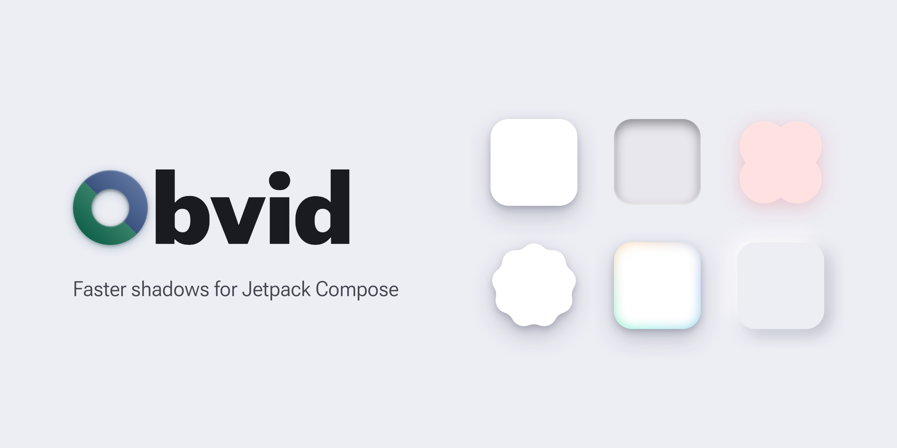
</picture>

**Obvid** (Ukrainian *обві́д*, "outline", pronounced [obˈʋid] (ob-veed)) replaces the `dropShadow` and `innerShadow`
modifiers of Jetpack Compose. Android's own `Canvas` draws the outline of each shape, and Obvid blurs it in NEON (Arm
SIMD) code. On Android 16–17, the pixels are identical to Compose's. On older versions, Obvid gives the same output as
on Android 16–17, which can differ a little from the Compose of that device. For most shapes, Obvid builds a shadow
7–13 times faster than Compose. For screens that open with many shadows, an opt-in builds them on worker threads, so
the main thread can go on with its frame.

## Contents

- [Who is it for?](#who-is-it-for)
- [Install and use](#install-and-use)
- [Numbers](#numbers)
  - [One rebuild](#one-rebuild)
  - [An animated glow](#an-animated-glow)
  - [The first frame of a new screen](#the-first-frame-of-a-new-screen)
  - [Parallel builds: a screen with many new shadows](#parallel-builds-a-screen-with-many-new-shadows)
  - [A stress test](#a-stress-test)
  - [Scrolling on a weak GPU](#scrolling-on-a-weak-gpu)
- [How it works](#how-it-works)
- [Quality and tests](#quality-and-tests)
- [Limits](#limits)
- [Build from source](#build-from-source)
- [To do](#to-do)
- [License and credits](#license-and-credits)

## Who is it for?

Apps whose shadows change or appear often. Compose builds each shadow as a bitmap on the main thread and then reuses
it; Obvid builds the same bitmap 7–13 times faster. It shows in:

- **Animated shadows:** a glow, a pulse, a loader, a morphing shape. Compose rebuilds the bitmap in each frame; Obvid
  rebuilds faster, and not at all when only the color, brush, or alpha changes.
- **New screens with many shadows:** the first frame, navigation, new list items. All their shadows are built in one
  frame. An opt-in moves these builds to worker threads
  ([parallel builds](#parallel-builds-a-screen-with-many-new-shadows)).
- **Inner shadows on a weak GPU:** Obvid draws only the bands along the edges, not the empty middle
  ([numbers](#scrolling-on-a-weak-gpu)).

For static shadows, Compose is fine: the bitmap is built once, and it costs almost nothing with either library. To
check your app, measure a screen, change the imports, and measure again.

## Install and use

Obvid is published to a Maven repository on GitHub Pages. Add the repository and the dependency:

```kotlin
// settings.gradle.kts
dependencyResolutionManagement { repositories { maven("https://desugar-64.github.io/obvid/maven") } }

// build.gradle.kts
dependencies { implementation("dev.serhiiyaremych:obvid:0.1.1") }
```

Then change the imports. The rest of your code stays the same: the modifiers take the same parameters, including the
Compose `Shadow`. Obvid needs Compose 1.13 or newer and minSdk 24. On ABIs other than arm64-v8a, it uses the Compose
shadows.

```diff
-import androidx.compose.ui.draw.dropShadow
-import androidx.compose.ui.draw.innerShadow
+import dev.serhiiyaremych.obvid.dropShadow
+import dev.serhiiyaremych.obvid.innerShadow
```

## Numbers

All numbers are medians from release builds (R8, AOT compilation `speed`), measured with Microbenchmark, Macrobenchmark,
and Perfetto on two devices:

- a Xiaomi Pad 5 (Snapdragon 860, Android 13) at 120 Hz: 8.3 ms for each frame;
- a Pixel 6 (Tensor, Android 17) at 90 Hz: 11.1 ms for each frame.

<details>
<summary>What the numbers mean</summary>

- **Frame time:** from the start of the frame to the end of its work on the render thread of the app (Macrobenchmark's
  `frameDurationCpuMs`).
- **Late frames:** frames that missed their deadline (`frameOverrunMs` > 0). Android counts them as janky.
- **Memory:** the anonymous memory of the app (RssAnon) at the end of the run.
- **Power:** the sum of the Pixel's power rails (ODPM) while the Glow tab of the demo runs, measured in both orders.

</details>

### One rebuild

**Up to 12.8 times faster on the Pad 5 (0.23 ms compared to 2.94 ms) and 9.5 times on the Pixel 6 (0.35 ms compared to
3.34 ms).** One rebuild of a 200 dp shape with a 24 dp blur radius, on one fast (big) core:

<picture>
  <source media="(prefers-color-scheme: dark)" srcset="docs/media/rebuild-time-dark.png">
  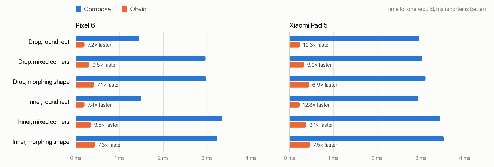
</picture>

<details>
<summary>The numbers as a table</summary>

| | Pixel 6<br>Compose | <br>Obvid | Xiaomi Pad 5<br>Compose | <br>Obvid |
|---|---|---|---|---|
| Drop, round rect | 1.44 ms | 0.20 ms | 2.96 ms | 0.24 ms |
| Drop, mixed corners | 2.96 ms | 0.31 ms | 3.03 ms | 0.33 ms |
| Drop, morphing shape | 2.97 ms | 0.42 ms | 3.10 ms | 0.45 ms |
| Inner, round rect | 1.49 ms | 0.20 ms | 2.94 ms | 0.23 ms |
| Inner, mixed corners | 3.34 ms | 0.35 ms | 3.44 ms | 0.38 ms |
| Inner, morphing shape | 3.23 ms | 0.44 ms | 3.52 ms | 0.47 ms |

</details>

A 120 Hz frame has 8.3 ms for all the work of the app. About 2 Compose rebuilds of a round rect fit into it on the
Pad 5, or 35 Obvid rebuilds (Pixel 6: 5 and 40).

### An animated glow

Three surfaces with a glow that shows that an agent is thinking, 6 s. Either the blur radius and the brush animate, or
only the brush turns. **On the Pad 5, when only the brush turns, Compose is late on 100% of the frames and Obvid on
20%:** a new brush makes Compose rebuild, but not Obvid (Pixel 6: 5.4 ms compared to 10.3 ms per frame).

<picture>
  <source media="(prefers-color-scheme: dark)" srcset="docs/media/frames-glow-dark.png">
  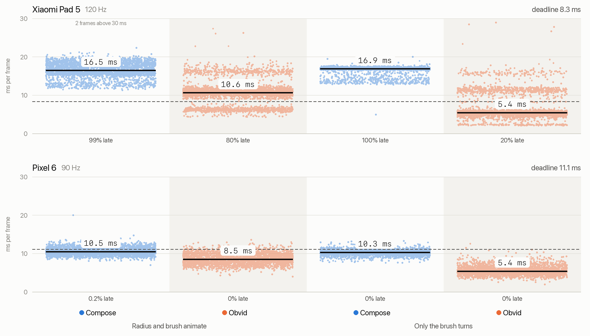
</picture>

One dot for each frame of five runs. The Obvid dots on the Pad 5 make groups about 5 ms apart, one group for each run:
the wait for a buffer from the system (`dequeueBuffer`) changes between runs, not the shadow work.

<details>
<summary>The numbers as a table</summary>

| | Pad 5<br>Compose | <br>Obvid | Pixel 6<br>Compose | <br>Obvid |
|---|---|---|---|---|
| Blur radius and brush animate: frame time p50 / p90 | 16.5 / 18.9 ms | 10.6 / 15.2 ms | 10.5 / 11.9 ms | 8.5 / 10.4 ms |
| Late frames | 99% | 80% | 0.2% | 0% |
| Only the brush turns: frame time p50 / p90 | 16.9 / 17.2 ms | 5.4 / 11.4 ms | 10.3 / 11.0 ms | 5.4 / 7.1 ms |
| Late frames | 100% | 20% | 0% | 0% |
| App memory at the end (blur radius and brush) | 432 MB | 35 MB | 1,054 MB | 50 MB |
| Power, only the brush turns (full device, 60 s) | | | 2.58 W | 0.90 W |

</details>

Compose also keeps each new bitmap until the view detaches, so an animated shadow adds hundreds of MB in seconds.
Obvid keeps one bitmap for each shadow.

<picture>
  <source media="(prefers-color-scheme: dark)" srcset="docs/media/memory-dark.png">
  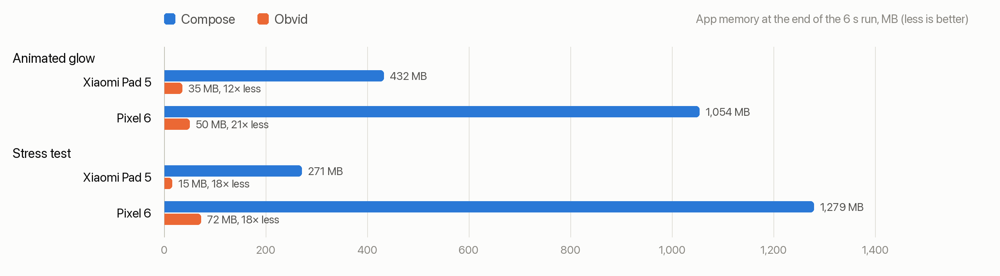
</picture>

### The first frame of a new screen

The app is idle for one second, then a tap shows a 200 dp card; the frame that draws it is measured. **On the Pad 5,
Obvid draws this frame twice as fast: 11.0 ms compared to 22.2 ms (Pixel 6: 7.0 ms compared to 10.0 ms).**

A first build is slower than a rebuild: it blurs the shape into new memory, and after idle the main thread often runs
on a little core (refer to [the parts of a first build](docs/how-it-works.md#frame-timing)).

<picture>
  <source media="(prefers-color-scheme: dark)" srcset="docs/media/first-frame-dark.png">
  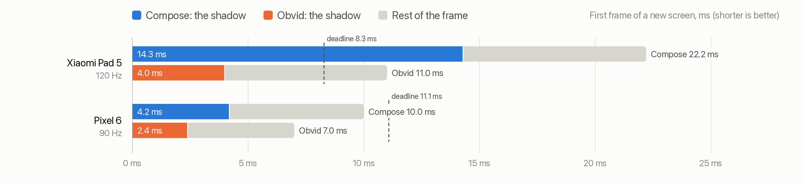
</picture>

<details>
<summary>The numbers as a table</summary>

| | Pad 5<br>Compose | <br>Obvid | Pixel 6<br>Compose | <br>Obvid |
|---|---|---|---|---|
| The frame (no shadow: 5.3 / 4.3 ms) | 22.2 ms | 11.0 ms | 10.0 ms | 7.0 ms |
| The shadow's part of the frame | 14.3 ms | 4.0 ms | 4.2 ms | 2.4 ms |

</details>

<details>
<summary>Perfetto traces</summary>

One run on the Pad 5 (the medians are above). The two screenshots show 26 ms at the same scale. The selection is the
frame of the main thread (`Choreographer#doFrame`): 22.1 ms with Compose and 11.1 ms with Obvid.

<picture>
  <source media="(prefers-color-scheme: dark)" srcset="docs/media/trace-pad5-first-frame-compose-dark.png">
  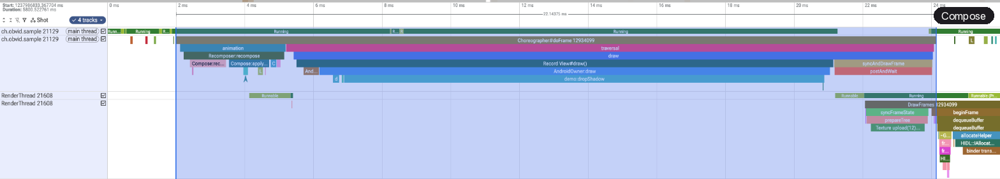
</picture>
<picture>
  <source media="(prefers-color-scheme: dark)" srcset="docs/media/trace-pad5-first-frame-obvid-dark.png">
  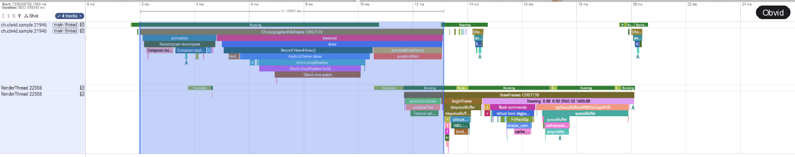
</picture>

</details>

### Parallel builds: a screen with many new shadows

By default, the main thread builds the bitmap of each new shadow in the draw, one after the other, as in Compose. With
the opt-in parallel builds, up to 3 worker threads on the big cores build them during the layout. The draw then only
uses the finished bitmaps.

<picture>
  <source media="(prefers-color-scheme: dark)" srcset="docs/media/parallel-timeline-dark.png">
  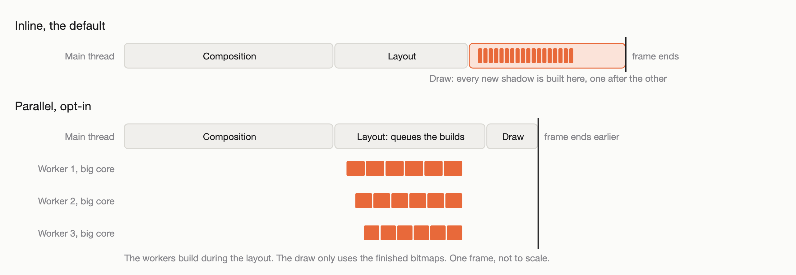
</picture>

A tap opens the demo's feed. In that one frame, the demo creates its whole UI, lays it out and draws it. On the Pad 5,
that is 36 new shadows. **Obvid's time on the main thread goes from 16.5 to 2.4 ms on the Pad 5, and from 13.2 to
1.1 ms on the Pixel 6.** The frame is 10.3 and 14.0 ms shorter.

<picture>
  <source media="(prefers-color-scheme: dark)" srcset="docs/media/parallel-builds-dark.png">
  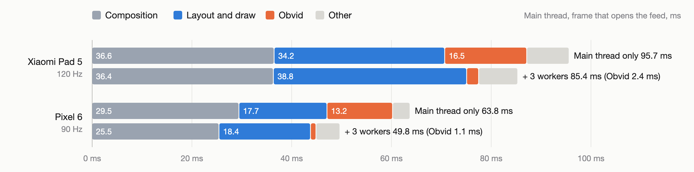
</picture>

<details>
<summary>The numbers as a table</summary>

Medians of 5 runs, in both orders (main thread only, + 3 workers, + 3 workers, main thread only). The chart shows the
mean of the two orders. "Obvid" is the builds on the main thread; with workers, it is the queueing in the layout and
the waits in the draw.

| | Pad 5<br>main thread only | <br>+ 3 workers | Pixel 6<br>main thread only | <br>+ 3 workers |
|---|---|---|---|---|
| The frame | 101.0 / 90.4 ms | 82.7 / 88.1 ms | 63.8 / 63.8 ms | 47.7 / 51.8 ms |
| Obvid on the main thread | 17.7 / 15.2 ms | 3.0 / 1.8 ms | 13.2 / 13.1 ms | 1.1 / 1.1 ms |
| Layout and draw, with Obvid | 55.8 / 45.5 ms | 40.4 / 41.9 ms | 31.0 / 30.6 ms | 19.5 / 19.4 ms |
| Composition | 36.5 / 36.6 ms | 35.0 / 37.8 ms | 29.0 / 30.0 ms | 25.1 / 25.9 ms |

Composition is the same work in both modes, but it is noisy: on the Pixel 6, it takes 14–45 ms from run to run, with
the core and the clock that the main thread gets. Its 4 ms difference in the chart is this noise. On the Pad 5, the
layout of the other elements is also noisy (+3 and +11 ms in the two orders).

</details>

<details>
<summary>Other screens</summary>

- **One card** ([first frame](#the-first-frame-of-a-new-screen)): 1.3 ms slower on the Pixel 6, a tie on the Pad 5.
  There is nothing to do in parallel, but the handoff to a worker costs time.
- **Navigation after 4 s of idle:** the first frame is 7–14% shorter on the Pixel 6, a tie on the Pad 5. After idle,
  the Pad 5 runs the layout on a little core.
- **Shadows that change:** they rebuild on the main thread, as before. The animated glow and scrolling are a tie on
  both devices.
- **One rebuild,** the default against the previous version: a tie on all routes (Pixel 6, Microbenchmark).
- **CPU and power** (Pixel 6): the app's total CPU time and the energy of the CPU power rails stay the same, within
  the noise.

</details>

### A stress test

A wall of morphing tiles, about 20 shadows rebuilt in each frame, 6 s. **On the Pad 5, Obvid draws 3.4 times more
frames (210 compared to 61) and uses 18 times less memory (15 MB compared to 271 MB). On the Pixel 6: 398 compared to
131 frames, 72 MB compared to 1,279 MB.**

Recorded on the Pad 5, Compose on the left, Obvid on the right; the corner box enlarges the demo's fps counter. Plays
at 60 fps.

<picture>
  <source media="(prefers-color-scheme: dark)" srcset="docs/media/compose-vs-obvid-dark.webp">
  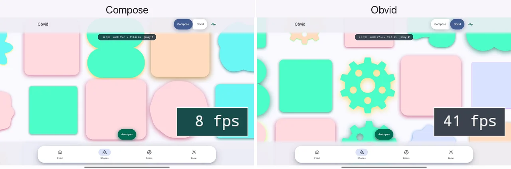
</picture>

<picture>
  <source media="(prefers-color-scheme: dark)" srcset="docs/media/frames-stress-dark.png">
  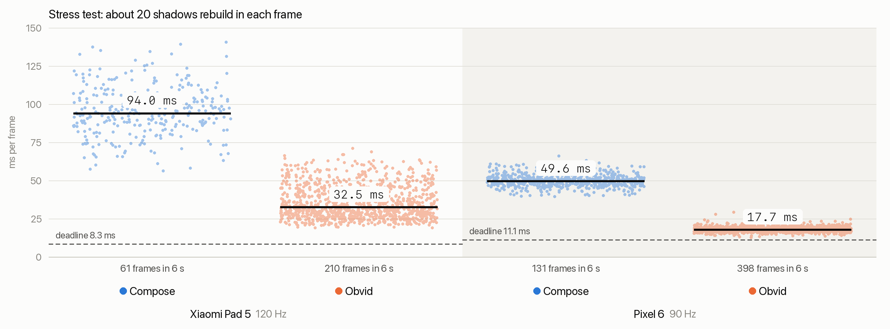
</picture>

<details>
<summary>The numbers as a table</summary>

| | Pad 5<br>Compose | <br>Obvid | Pixel 6<br>Compose | <br>Obvid |
|---|---|---|---|---|
| Frames drawn | 61 | 210 | 131 | 398 |
| Frame time p50 | 94 ms | 32.5 ms | 49.6 ms | 17.7 ms |
| App memory at the end | 271 MB | 15 MB | 1,279 MB | 72 MB |

</details>

### Scrolling on a weak GPU

A feed with many static inner shadows scrolls on a tablet with a weak GPU (Unisoc T616, Android 14). **The feed scrolls
at 46.5 fps with Obvid and at 42 fps with Compose, and Obvid has one-third fewer late frames.**

<details>
<summary>Perfetto traces</summary>

The two screenshots show 95 ms at the same scale. The selection is the GPU time for one frame: about 20 ms with
Compose, and the frames are late (orange); about 14 ms with Obvid's inner shadows drawn in bands, and the frames are on
time (green).

<picture>
  <source media="(prefers-color-scheme: dark)" srcset="docs/media/trace-unisoc-bands-compose-dark.png">
  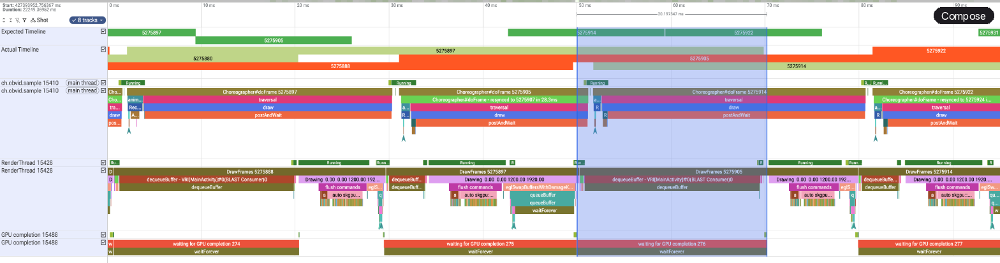
</picture>
<picture>
  <source media="(prefers-color-scheme: dark)" srcset="docs/media/trace-unisoc-bands-obvid-dark.png">
  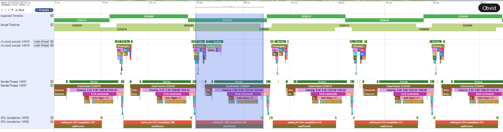
</picture>

</details>

## How it works

Compose builds each shadow on the CPU, on the main thread, with Skia (the graphics library of Android). A software
`Canvas` with a `BlurMaskFilter` draws the outline into a one-channel (`ALPHA_8`) bitmap, and Skia blurs it. Then the
GPU draws the bitmap with the shadow color or brush. Obvid keeps this design and replaces only the build step:

<picture>
  <source media="(prefers-color-scheme: dark)" srcset="docs/media/pipeline-dark.png">
  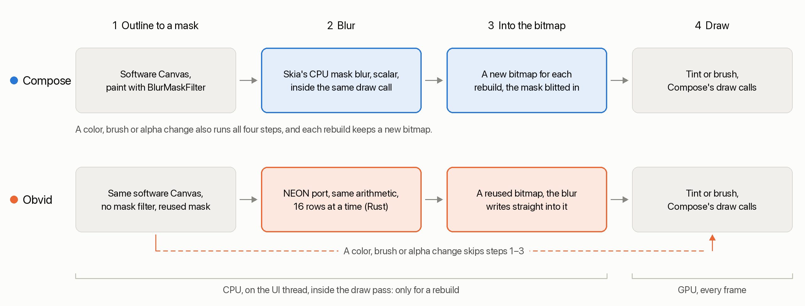
</picture>

1. The same software `Canvas` draws the outline, without blur, into a mask: a one-channel image that Obvid keeps and
   uses again. Android draws it, so the edges are the same as in Compose.
2. A NEON port of Skia's mask blur writes directly into the shadow bitmap. It uses Skia's three box passes and Skia's
   rounding, so the pixels are the same as Skia's. Round rects and frames use Skia's nine-patch method: blur a small
   copy of the shape, then stretch it.
3. Compose draws the bitmap with its own draw calls. Obvid adds no custom shaders and no GPU context.

Skia's CPU blur for shadows is scalar: it processes one pixel at a time. On a Pixel 6, the blur, the copy from mask to
bitmap, and the memory allocations are 70–85% of a Compose rebuild. Obvid does the same arithmetic on 16 rows at a time
in NEON, skips the flat middle of large shapes, and uses its buffers again: a drop-shadow rebuild does one allocation
(Compose: 24–38).

In Obvid, only the geometry causes a rebuild: the shape, size, layout direction, density, blur radius, spread, and (for
inner shadows) offset. The color, brush, alpha, blend mode, and the offset of a drop shadow change only the draw call.
Shadows with the same geometry share one bitmap. For more information, refer to
[docs/how-it-works.md](docs/how-it-works.md).

## Quality and tests

On a Pixel 6 (Android 17), the output of Obvid is identical to the output of Compose: PSNR ∞, maximum error 0 of 255
levels, in all device tests, shadow bitmaps, and screen captures. In the figure, the bottom row is the difference
between the two screen captures, made 16 times brighter. A black tile means that no pixel is different.

<picture>
  <source media="(prefers-color-scheme: dark)" srcset="docs/media/quality-pixel6-dark.png">
  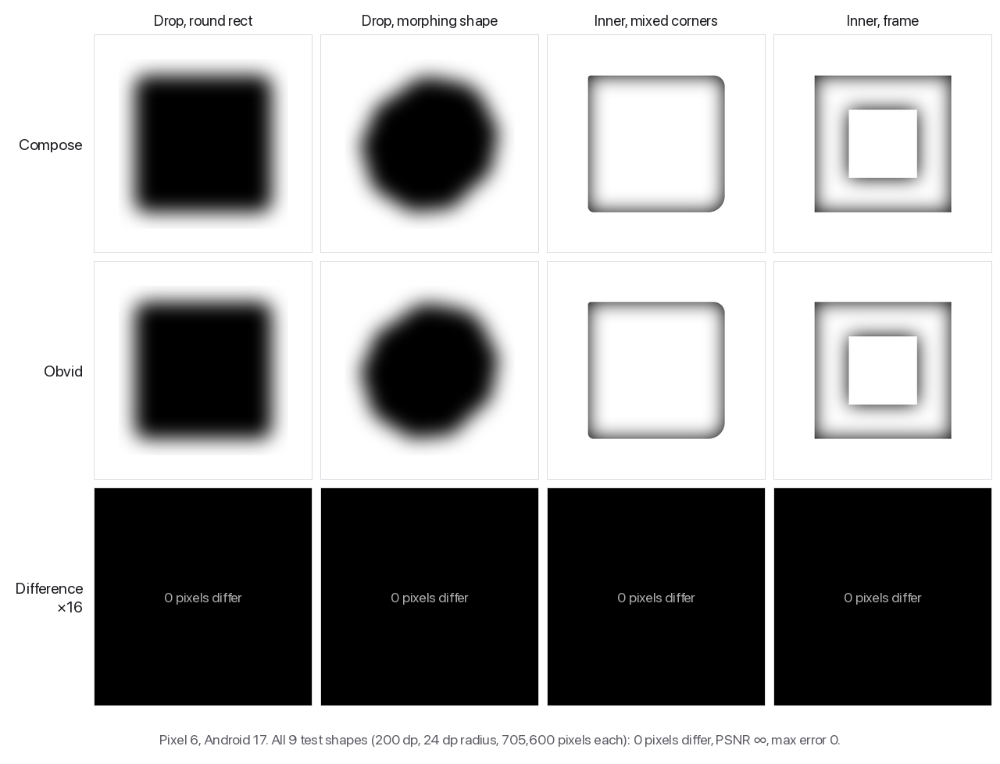
</picture>

Skia is part of Android, not of Compose. So on Android 15 and older, Compose blurs with an older Skia, and its output
can differ from Obvid's. Obvid gives one output on all versions: that of current Compose on Android 16–17. On emulators
of Android 8 and 9, the measured difference is PSNR 42–67 dB; round rects differ most (PSNR 44–55 dB, maximum error
58–62 of 255 levels).

- **Device tests** compare the bitmaps and screen captures of Obvid with those of Compose: shapes, sizes, blur radii,
  spreads, offsets, colors, brushes, blend modes, animations, and Google's Compose shadow snippets. They run on a
  Pixel 6 (Android 17), a Galaxy S10 (Android 12), a Xiaomi Pad 5 (Android 13), and a Unisoc tablet (Android 14). On
  Android 16–17, the tests require identical pixels; an Android 16 emulator passed the round-rect identity checks
  during development. On older versions, the tests measure the difference.
- **Rust tests** on the host compare the scalar blur with golden outputs from Skia's code, and the NEON kernels with
  the scalar blur.
- **A build guard** stops the build if the inner loop of the blur loses its NEON `smlal` instructions. The scalar code
  that the compiler can make instead passes all the tests, but runs about 2 times slower.

## Limits

- [**arm64-v8a only.**](docs/limits.md#arm64-v8a-only) Other ABIs use the Compose shadows.
- [**Some shadows are not faster:**](docs/limits.md#some-cases-use-the-skia-of-the-device) rects, blur radius 0 and a few rare paths use the blur of the device's Skia, as in Compose.
- [**Compose's hard edge stays by default.**](docs/limits.md#composes-hard-edge-stays-by-default) A Compose shadow stops at a fixed distance from the shape, so a strong glow can end at a visible line. `ShadowExtent.Full` removes it for drop shadows.
- [**Compose 1.13 or newer, minSdk 24.**](docs/limits.md#compose-113-or-newer-minsdk-24)
- [**Threads:**](docs/limits.md#threads) by default, no background threads: the thread that draws a shadow builds it, as in Compose. [Parallel builds](#parallel-builds-a-screen-with-many-new-shadows) use up to 3 worker threads.
- [**Memory:**](docs/limits.md#memory) off-screen shadows stay cached for 3 s, up to 10 MiB.
- [**Size:**](docs/limits.md#size) Obvid adds approximately 68 KB to the download and 131 KB to the arm64 APK.

## Build from source

You need JDK 17 or newer, the Android SDK with NDK 30.0.16248370 (`sdk.dir` in `local.properties`; Android Studio writes
it), and [rustup](https://rustup.rs). `obvid/rust/rust-toolchain.toml` pins the Rust compiler and its Android target, and
rustup installs them during the first build. Gradle finds Cargo through `cargo.dir` in `local.properties`,
`$CARGO_HOME/bin`, `~/.cargo/bin`, or `PATH`, so Build and Run in Android Studio work without shell setup.

```sh
./gradlew :obvid:assembleRelease              # the AAR, with the Rust library built for arm64-v8a
./gradlew :obvid:publishToMavenLocal          # dev.serhiiyaremych:obvid into ~/.m2
cd obvid/rust && cargo test --release         # the NEON tests need an arm64 host (for example, Apple Silicon)
```

`sample/` is the demo app, `benchmark/` the Microbenchmarks, `macrobenchmark/` the frame benchmarks.
[`.claude/skills/build-and-measure/SKILL.md`](.claude/skills/build-and-measure/SKILL.md) describes the device tests,
benchmarks, profiling, and tracing; it is written for coding agents, but also works as a guide.

## To do

Ideas that were measured or scoped, but are not in Obvid yet:

- [ ] [Parallel rebuilds](docs/to-do.md#parallel-rebuilds): workers also for shadows that change size.
- [ ] [Faster first builds](docs/to-do.md#faster-first-builds): 3.5 ms on a Pad 5 little core after idle.
- [ ] [Fewer draw commands for shadows that scroll](docs/to-do.md#fewer-draw-commands-for-shadows-that-scroll): for tablets with a weak GPU.
- [ ] [Drop shadows under opaque content](docs/to-do.md#drop-shadows-under-opaque-content): opt-in, skip the hidden middle.
- [ ] [More shapes on the fast path](docs/to-do.md#more-shapes-on-the-fast-path): rects, blur radius 0, paths with spread.
- [ ] [A downsampled blur for large blur radii](docs/to-do.md#a-downsampled-blur-for-large-radii): opt-in, with its quality loss.
- [ ] [A GPU route](docs/to-do.md#a-gpu-route) for the simplest shapes, to compare with the CPU route.
- [ ] [More ABIs](docs/to-do.md#more-abis): 32-bit ARM and x86_64.
- [ ] [Maven Central](docs/to-do.md#maven-central), after the GitHub Pages repository shows that it is reliable.

## License and credits

Apache-2.0; refer to [LICENSE](LICENSE). The blur arithmetic and the nine-patch geometry are ports of Skia
(BSD-3-Clause); refer to [NOTICE](NOTICE). Obvid uses the shadow API and the draw path of Jetpack Compose, and Google's
Compose shadow snippets (Apache-2.0) are test scenes. The project started from the RGBA NEON blur kernels of my
earlier "Android Runtime, part 2" experiments, which I described on X in three parts:
[1](https://x.com/desugar_64/status/2120705022744842727), [2](https://x.com/desugar_64/status/2120705166764618028),
[3](https://x.com/desugar_64/status/2120705394183938550).

Obvid is not affiliated with Google.
