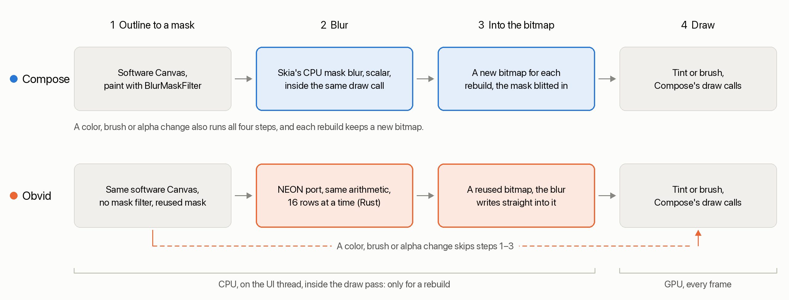
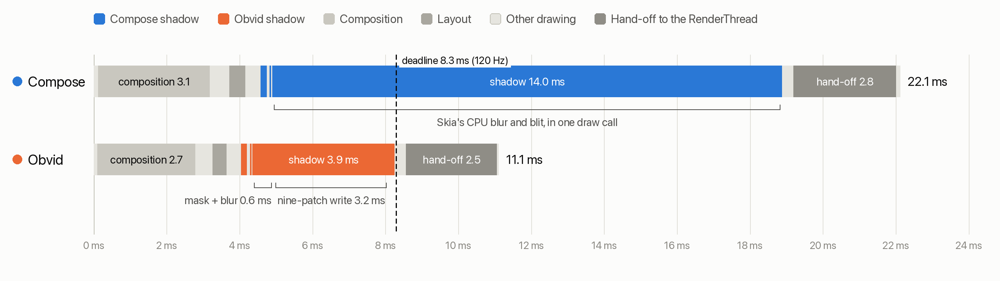

# How Obvid works

Obvid preserves the shadow design and Compose output, replacing the most time-consuming part of rebuilding.

## The pipeline, Compose and Obvid

When Compose's `DropShadowPainter` builds a shadow, it follows these steps:

1. It allocates an `ALPHA_8` bitmap sized to the shadow plus `2·(radius + spread)`.
2. The bitmap is placed in a software `Canvas`, and the outline is drawn with `BlurMaskFilter(radius, NORMAL)`.
3. Skia rasterizes the outline into a mask, blurs the mask on the CPU, and blits it into the bitmap.
4. The GPU draws the bitmap with the shadow color or brush.

`InnerShadowPainter` offsets and blurs the shape, then inverts the result using an opaque `Xor` rectangle. It fills the
outline with the bitmap as a shader. Both painters build on the UI thread during the draw pass.

<picture>
  <source media="(prefers-color-scheme: dark)" srcset="media/pipeline-dark.png">
  
</picture>

| Step | Compose | Obvid |
|---|---|---|
| Outline to A8 mask | A software `Canvas` (Skia on the CPU). The paint has a `BlurMaskFilter`. | The same type of software `Canvas`, without a mask filter, into a mask that Obvid uses again. |
| Blur | In the same draw call: the CPU mask blur of Skia (scalar). | A separate step: a NEON port in Rust, with the same arithmetic. |
| Bitmap | A new bitmap for each rebuild. Skia blits the mask into it. | A bitmap that Obvid uses again. The blur writes directly into it. |
| Final draw | Tint or brush, on the GPU. | The same Compose draw calls. |

A rebuild is required only when the geometry changes: the shape, size, layout direction, density, radius, or spread.
Changes to the offset of an inner shadow also require a rebuild. Changes to color, brush, alpha, blend mode, or the
offset of a drop shadow affect only the final draw. The Compose cache uses all parameters as its key except the drop
shadow offset. As a result, an animated color or alpha also triggers a rebuild in Compose.

### Frame timing

The figure illustrates the first frame of the single-card screen on the Xiaomi Pad 5. These are the same two frames as
the traces in the README. Each bar represents the `Choreographer#doFrame` of the main thread. Components are shown at
their actual positions in time using the same scale.

- **Compose:** The shadow takes 14.0 ms of a 22.1 ms frame. A single draw call performs both the blur and the blit.
- **Obvid:** The shadow takes 3.9 ms of an 11.1 ms frame. The mask and blur require 0.6 ms. Writing the nine-patch into
  the new bitmap takes 3.2 ms.

The initial build writes into new memory, often on a little core after one idle second. A warm rebuild of the same card
takes about 0.24 ms.

<picture>
  <source media="(prefers-color-scheme: dark)" srcset="media/frame-anatomy-dark.png">
  
</picture>

### Routes

On the CPU, Skia selects a route for each shape. Obvid uses the same routes:

- **Full mask** (paths, ovals such as `CircleShape`, round rects with mixed corners): Obvid rasterizes and blurs the
  full outline. It writes only the part the bitmap keeps.
- **Nine-patch** (round rects with equal corners): Skia blurs a small copy of the round rect and stretches it. On all
  Android versions, Obvid uses the `filterRRectToNine` geometry of Android 16–17. Obvid keeps the blurred copy. Thus, a
  change of offset, size, or spread only stretches the copy again.
- **Frames** (two nested rects): the rect nine-patch of Skia, the same stretch without a center.
- **Routes that stay on the Skia of the device:** rects and rect-shaped paths (the analytic rect blur of Skia), radius
  0, inner shadows of paths with positive spread at some offsets, and drop-shadow frames with positive spread. For
  these routes, Obvid runs the Compose calls into its own bitmap.

If the device is not arm64 or the native library does not load, the modifiers are the Compose modifiers.

## Same arithmetic, same results

Android changes the radius to sigma: `σ = 0.57735·r + 0.5` in `float` (r in px). `SkBlurMaskFilterImpl.cpp` sets a
maximum of 128. Below σ = 2 (radius less than approximately 2.6 px), `SkMaskBlurFilter.cpp` convolves directly with the
discrete Gaussian of `SkGaussFilter`, in 8.8 fixed point. Obvid runs that code in NEON, 16 pixels at a time, with the
same bytes as a scalar port of it.

From σ = 2, the `PlanGauss` of Skia approximates the Gaussian with three box filters:

- window `d = floor(σ·3·√(2π)/4 + 0.5)`;
- boxes with the widths d, d, d for an odd d, or d, d, d + 1 for an even d;
- the sum of the combined kernel is `divisor = d³` (odd) or `d³ + d²` (even).

Each output byte is the integer sum of the kernel multiplied by a fixed-point reciprocal. There is no division for each
pixel:

```
weight = round(2³² / divisor)        // once per blur, in double
out    = (weight·sum + 2³¹) >> 32
```

The horizontal pass runs first and its result is rounded to bytes. Then the vertical pass runs. The sums are exact
integers, so Obvid calculates them in its own way. It uses differences and two running integrators, not three ring
buffers of Skia. But rounding must match Skia's. A NEON rounding multiply (`sqrdmulh`) costs less, but it gives a
different byte for some windows. Obvid adds `2³¹ + weight·sum` in 64-bit lanes with `smlal` and it keeps bits 32 to 39.
Obvid copies the A8 source-over blit of Skia (`SkDiv255Round`) the same way. This blit adds the stroke of a path with
spread.

## Why Obvid is faster than the Skia path

Skia uses SIMD in its blitters and raster pipeline. But the CPU mask blur for shadows is scalar. On a Pixel 6, this
blur, the blit from mask to bitmap, and allocations are 70–85% of a Compose rebuild. The rasterization of the outline is
1% or less.

The time for one rebuild of a 200 dp shadow with a 24 dp radius (Microbenchmark median, one big core):

| | Pixel 6<br>Compose | <br>Obvid | Xiaomi Pad 5<br>Compose | <br>Obvid |
|---|---|---|---|---|
| Drop, round rect | 1.44 ms | 0.20 ms | 2.96 ms | 0.24 ms |
| Drop, mixed corners | 2.96 ms | 0.31 ms | 3.03 ms | 0.33 ms |
| Drop, morphing shape | 2.97 ms | 0.42 ms | 3.10 ms | 0.45 ms |
| Inner, round rect | 1.49 ms | 0.20 ms | 2.94 ms | 0.23 ms |
| Inner, mixed corners | 3.34 ms | 0.35 ms | 3.44 ms | 0.38 ms |
| Inner, morphing shape | 3.23 ms | 0.44 ms | 3.52 ms | 0.47 ms |

The parts of Obvid, with their code in `obvid/rust/src/neon/`:

- **16 lines in one register.** A mask has one byte for each pixel. Thus, one NEON register holds 16 rows (or columns),
  one in each lane. The horizontal pass transposes 16×16 blocks in the registers (`neon/transpose.rs`), so its rows
  become lanes. The vertical pass reads the intermediate rows directly. The two passes use the same three-box kernel
  (`neon/box3.rs`).
- **Interior skip.** Most of a shadow mask is flat: 255 inside and 0 outside. `neon/flags.rs` finds areas where the
  input does not change, 16 steps at a time. In such an area, output equals input. Thus, the kernel stores the input
  without calculation and starts again from a state it knows in closed form. Without this detection, a rebuild takes
  10–49% more time.
- **A8 stores in NEON** (`neon/a8.rs`): the source-over blit for spread and the `255 − v` inversion of inner shadows.
  The nine-patch route does the inversion during its write.
- **No new buffers for each rebuild.** Obvid reuses scratch buffers and bitmaps. The blur writes only the window the
  shadow bitmap keeps, directly into the bitmap. A drop-shadow rebuild makes one Java allocation, and Compose makes
  24–38 (inner shadows: 8 versus 30–44).

The remaining time: the NEON kernel is 50–70% of a rebuild and Android's mask rasterizer is 13–28%. The rasterizer must
stay the Android rasterizer, because its anti-aliasing sets the mask that Obvid must match.

## Full extent

Compose makes the bitmap of a drop shadow as large as the shape plus `radius + spread` on each side. But the blur
continues further: at the radius it still has approximately 8–12 of 255 levels behind a solid shape. With
`ShadowExtent.Full`, the bitmap size comes from the point where the blur is sure to be 0.

The two blur paths are separable. Each pass sums non-negative values, rounded by a step that does not decrease. Thus no
output can be larger than the output of a straight edge. Obvid finds the first offset at which the 1D step response of a
run of 255s rounds to 0. This offset is a margin for all shapes, measured from their pixel bounds. It is approximately
1.4–1.6 times the radius (border of the blur itself is approximately 1.63 times).

Obvid draws the shape as Compose draws it, on a larger canvas moved by full pixels. Thus all routes keep their decisions
and their arithmetic. The draws that stay on the Skia of the device get the wider reach of that Skia (`3·⌈σ⌉ + 1`). Its
analytic rect blur continues further than the box blur.

## Inner shadows in bands

The bitmap of an inner shadow is zero in the middle. But Compose fills the full outline. Thus, the GPU shades each
pixel in the middle, only to blend a transparent source.

While Obvid builds the bitmap, it finds a rectangle of zeros (the hole):

- On the full-mask routes, it finds the hole during the inversion pass.
- On the nine-patch route, it finds the hole once for each small mask it keeps. Then it maps the hole through the
  stretch.

If the hole is sufficiently large, Obvid draws the same fill at most four times. Each draw is clipped to one band around
the hole. Rect clips are not anti-aliased, so the bands touch without overlap and without gaps. On the GPU, these clips
are scissors, so the GPU never shades the hole. The output is identical, because each pixel that Obvid skips would blend
a zero. Two conditions keep this true:

- **Convex outlines only.** In the GPU renderer of Android, the anti-aliased edge of a concave path changes with the
  clip, because the renderer selects a different path renderer for a clipped path. Rects, round rects and convex paths
  do not change.
- **Blend modes in which a transparent source does not change the destination**: `SrcOver`, `DstOver`, `DstOut`,
  `SrcAtop`, `Xor`, `Dst`, `Plus`, `Screen`.

On a tablet with a weak GPU, a feed with many shadows scrolls at 46.5 fps with bands and at 42 fps with Compose. The GPU
time for each frame is 29% less, and there are one-third fewer janky frames.

## How Obvid stays fast

The native library is `no_std` Rust (`core` and `alloc`). The panic system of `std` would add a backtrace symbolizer,
and Android discards its output. The stripped library is smaller than 100 KB.

The speed can decrease even when all tests pass. With link-time optimization, LLVM once proved that the weight is not
negative. Then it replaced the kernel's widening multiply-accumulate with scalar 64-bit multiplies for each lane. The
bytes stayed the same, but the kernel became about twice as slow. Now the optimizer cannot see the value of the weight.
A Gradle task disassembles the unstripped library. The build fails if one of the four variants of the hot loop does not
have exactly 8 `smlal`/`smlal2` instructions. It also fails on lane-to-scalar moves.

## How Obvid stays exact

- **Device tests** compare the bitmaps and screen captures of Obvid with those of Compose on Android 16–17. They require
  identical pixels. They cover shapes, sizes, radii, spreads, offsets, colors, brushes, blend modes, animations, and
  shadow snippets from Google.
- **Band tests** compare the bands with a single draw of the same bitmap on all Android versions, both plain and in a
  scaled and rotated layer. Neither depends on the device's Skia.
- **Host tests** compare the scalar port with golden outputs from Skia's `SkMaskBlurFilter.cpp`. During development, that code
  was compiled unchanged, and its outputs are kept in the tests. The host tests also compare the NEON kernels and
  stores with the scalar port.
- **A cross-version quality test** measures the difference from the Compose of the device on older Android versions: the
  differing pixels, the largest difference, and the PSNR. It does not require identical pixels because Compose draws
  with an older Skia.
